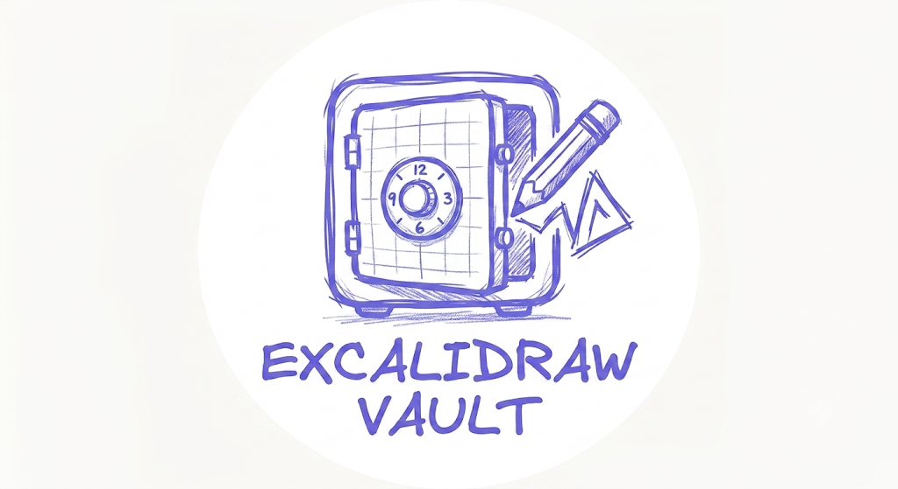

# Excalidraw Vault & Auto-Save Browser Extension

Excalidraw Vault is a clean, lightweight browser extension that automatically backs up your Excalidraw drawings to `chrome.storage.local` in the background. It provides a native-feeling library panel directly within Excalidraw's user interface, allowing you to browse, search, rename, tag, export, and switch drawings with a single click.

No more manual exports or fear of losing your sketches when browser history is cleared!

---

## Key Features

- 🔄 **Continuous Background Auto-Save**: Saves changes to browser extension storage incrementally as you sketch.
- 🖼️ **Dynamic Canvas Thumbnails**: Automatically captures scaled-down previews of your drawings (debounced to save CPU cycles).
- 📂 **Native-Feeling Sidebar Panel**: A responsive, glassmorphic panel sliding out from the right, supporting dark and light themes automatically.
- 🔍 **Interactive Search & Tags**: Filter your sketches instantly by name or custom tags.
- 🏷️ **Custom Tag Manager**: Group drawings together using tags (e.g., *Draft*, *Flowchart*, *System Design*).
- 💾 **Safe Sketch Restoration**: Swap active drawings instantly with smooth fade-out loader transitions.
- 📥 **Local `.excalidraw` Exporter**: Download any drawing's JSON configuration with a single click.
- 🗑️ **Trash Bin with Confirmation**: Safely delete previous drawings with a custom confirmation dialogue.

---

## Installation Instructions

Follow these quick steps to load the extension in your browser:

### Chrome / Edge / Brave / Opera (Chromium-based)

1. Open your browser and navigate to the Extensions page:
   - Chrome: `chrome://extensions/`
   - Edge: `edge://extensions/`
2. Enable **Developer mode** (typically a toggle in the top-right corner).
3. Click the **Load unpacked** button in the top-left corner.
4. Select the workspace folder:
   `/home/atoms/programming/web/excalidraw-storage`
5. Go to [excalidraw.com](https://excalidraw.com) and start drawing! You will see the floating folder icon on the bottom right.

### Firefox

1. Open Firefox and go to `about:debugging`.
2. Click **This Firefox** on the left menu.
3. Click the **Load Temporary Add-on...** button.
4. Navigate to `/home/atoms/programming/web/excalidraw-storage` and select `manifest.json`.
5. Open [excalidraw.com](https://excalidraw.com) to see the extension in action.

---

## Code Architecture

- [manifest.json](file:///home/atoms/programming/web/excalidraw-storage/manifest.json): Configuration registering content scripts, styles, background worker, and storage permissions.
- [background.js](file:///home/atoms/programming/web/excalidraw-storage/background.js): Service worker initializing the local DB structures.
- [content.js](file:///home/atoms/programming/web/excalidraw-storage/content.js): The core driver. Monitors canvas, takes debounced screenshots, injects the library sidebar, manages transitions, and updates drawings.
- [content.css](file:///home/atoms/programming/web/excalidraw-storage/content.css): CSS variables supporting dynamic dark mode matching, glassmorphism, pulse indicators, and responsive card layouts.
- [icon.svg](file:///home/atoms/programming/web/excalidraw-storage/icon.svg): Vector logo for the browser extension.

---

## Data Structure

Drawings are stored under the key `drawings` in `chrome.storage.local` with the following structure:

```json
{
  "activeDrawingId": "dwg_1722026385000",
  "drawings": {
    "dwg_1722026385000": {
      "id": "dwg_1722026385000",
      "name": "Architecture Sketch",
      "elements": [...],
      "appState": {...},
      "tags": ["Design", "System"],
      "createdAt": 1722026385000,
      "updatedAt": 1722026402000,
      "thumbnail": "data:image/jpeg;base64,..."
    }
  }
}
```
